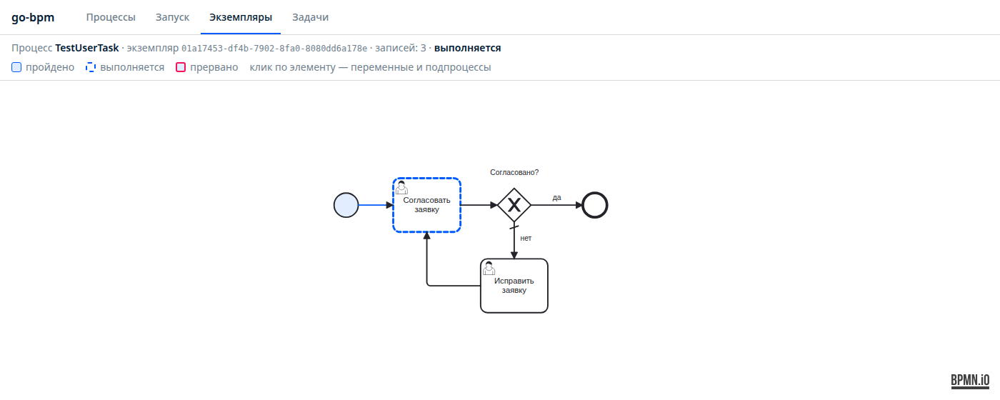

# HTTP API и консоль

JSON API (`httpapi`) и веб-консоль (`webui`) работают на обычном `http.ServeMux` вашего сервиса:

```go
mux := http.NewServeMux()
httpapi.Register(mux, e, history)                                  // /api/v1/processes, /api/v1/instances
httpapi.RegisterUserTasks(mux, engine.NewUserTaskService(pool, e)) // /api/v1/tasks
webui.Register(mux, history)                                       // /ui/, /ui/history/
```

Каждая часть подключается отдельно: сервису без задач пользователей не нужен `RegisterUserTasks`, сервису без
консоли — `webui`. Консоль работает поверх API, поэтому ей нужны оба `Register` из `httpapi` на том же mux.

> **Авторизации нет.** API и консоль не проверяют, кто их вызывает, а пользователя и его группы в задачах принимают
> на веру из запроса. Закрывайте их своим middleware, а в API задач подставляйте пользователя и группы из
> аутентификации, а не из тела запроса клиента.

Ошибки — JSON `{"error": "текст"}` с кодом 400 (неверный запрос), 403, 404 или 409. Время — RFC 3339, id — UUID.

## Процессы

### `GET /api/v1/processes`

Корневые процессы (без встроенных подпроцессов) с числом экземпляров по статусам:

```json
{"processes": [
  {"id": "OrderApproval", "name": "Согласование заказа", "instances": {"completed": 2, "running": 1}}
]}
```

`name` — атрибут `name` процесса в BPMN. Счётчики считаются по `bpm_process_instance`, то есть только при
включённом `History.ToDB`.

### `GET /api/v1/processes/{name}`

Процесс с XML BPMN: `{"id": "...", "name": "...", "bpmn": "<?xml ..."}`. Нет процесса — 404.

### `POST /api/v1/processes/{name}/instances`

Запустить процесс:

```json
{"variables": {"amount": 5000, "category": "vip"}, "businessKey": "order-2"}
```

Оба поля необязательны. Ответ `201`:

```json
{"id": "01a17411-e69b-7ea7-a8e1-e0713d1c0d9c"}
```

Процесс выполняется асинхронно: ответ означает, что старт записан в очередь, а не что процесс прошёл первые шаги.
Экземпляр сразу виден в `GET /api/v1/instances` со статусом `running`. Неизвестный процесс — 404.

## Экземпляры

### `GET /api/v1/instances`

| Параметр | Что это |
|---|---|
| `processName` | id процесса; у встроенного подпроцесса — `<процесс>.<id подпроцесса>` |
| `status` | `running`, `completed`, `failed` |
| `businessKey` | точное совпадение |
| `limit` | по умолчанию 100, не больше 1000 |
| `before` | id экземпляра: вернуть более старые (страница) |

```json
{"instances": [
  {"instance_uid": "01a17411-e69b-...", "process_name": "OrderApproval", "business_key": "order-2",
   "status": "running", "created_at": "2026-10-25T20:18:12.639587+03:00", "updated_at": "..."},
  {"instance_uid": "01a17412-d167-...", "process_name": "testSubProcess",
   "parent_instance_uid": "01a17412-d161-...", "status": "completed", "...": "..."}
]}
```

Сортировка — от новых к старым. Следующая страница — `before=<instance_uid последнего>`. Ничего не нашлось —
`{"instances": []}`. Неверный `status`, `limit` или `before` — 400.

### `GET /api/v1/instances/{id}`

Один экземпляр в том же формате. Нет — 404.

### `GET /api/v1/instances/{id}/history`

История экземпляра; `?withChildren=true` — вместе с дочерними (подпроцессы, call activity).

```json
{"records": [
  {"id": 13, "event": "completed", "instance_uid": "01a17411-...", "process_name": "OrderApproval",
   "element_id": "CheckOrder", "variables": {"amount": 5000, "checked": true, "notified": false},
   "created_at": "2026-10-25T20:18:12.641234+03:00"}
]}
```

`event` — `activated` (задача поставлена и ждёт: service task, таймер, user task, call activity), `completed`,
`terminated` (прервана граничным событием). `variables` — у старта и задач; у переходов и шлюзов поля нет.
У дочерних записей — `parent_instance_uid` и `parent_element_id`. Нет записей — 404.

## Задачи пользователей

### `GET /api/v1/tasks`

| Параметр | Что это |
|---|---|
| `assignee` | задачи, назначенные пользователю |
| `candidateUser` | задачи, которые пользователь может взять: он в `candidate_users` |
| `candidateGroup` | то же для групп; можно повторять или писать через запятую: `managers,admins` |
| `processName`, `instanceId`, `businessKey` | фильтры |
| `status` | `created` (открытые, по умолчанию) или `completed` |
| `limit`, `before` | страницы, как у экземпляров |

`assignee` и `candidateUser`/`candidateGroup` объединяются через «или»: запрос
`?assignee=bob&candidateUser=bob&candidateGroup=managers` вернёт «мои задачи и те, что я могу взять». Среди
кандидатов — только ещё не взятые задачи, плюс задачи без исполнителя и кандидатов (их может взять любой).

```json
{"tasks": [
  {"task_uid": "01a17411-e6a2-7124-96ad-a88df98da3c6", "instance_uid": "01a17411-e69b-...",
   "process_name": "OrderApproval", "element_id": "Approve", "name": "Согласовать заказ",
   "business_key": "order-2", "candidate_users": [], "candidate_groups": ["managers"], "status": "created",
   "created_at": "...", "updated_at": "..."}
]}
```

Поля, которые есть не всегда (пустые не пишутся): `assignee`, `form_key`, `business_key`, `claimed_at` (когда
назначена: взята или назначена при создании), `completed_by`, `completed_at`.

### `GET /api/v1/tasks/{id}`

Задача и `variables` — переменные процесса на момент создания задачи: данные для формы.

### `POST /api/v1/tasks/{id}/claim`

Взять задачу в работу: `{"userId": "bob", "groups": ["managers"]}` → 204.

- 403 — пользователь не кандидат;
- 409 — задачу уже взял другой или она выполнена;
- повторный `claim` своей задачи — 204, ничего не меняется.

### `POST /api/v1/tasks/{id}/unclaim`

Вернуть в очередь кандидатов: `{"userId": "bob"}` → 204. Только исполнитель, иначе 409.

### `POST /api/v1/tasks/{id}/complete`

Выполнить: `{"userId": "bob", "variables": {"approved": true}}` → 204.

- Только исполнитель (409 — не назначена пользователю). Задачу кандидатов сначала берут `claim`.
- `variables` добавляются к переменным процесса.
- Ответ 204 значит, что задача выполнена и процесс поставлен в очередь дальше. Ошибки следующих шагов (упавший
  метод) в ответ не попадут — их повторяет очередь, как любой шаг.

| Код | Когда |
|---|---|
| 400 | неверный id или JSON, нет `userId` |
| 403 | не кандидат (`claim`) |
| 404 | нет задачи |
| 409 | выполнена, взята другим, не назначена пользователю |

### Из Go без HTTP

Всё то же есть в `engine.UserTaskService`:

```go
tasks := engine.NewUserTaskService(pool, e)
list, _ := tasks.ListTasks(ctx, engine.TaskFilter{CandidateUser: "bob", CandidateGroups: []string{"managers"}})
_ = tasks.Claim(ctx, list[0].TaskUid, "bob", []string{"managers"})
_ = tasks.Complete(ctx, list[0].TaskUid, "bob", map[string]any{"approved": true})
```

Ошибки — `engine.ErrTaskNotFound`, `ErrTaskCompleted`, `ErrTaskClaimed`, `ErrNotCandidate`, `ErrNotAssignee`,
`ErrUserRequired`; проверяйте через `errors.Is`.

## Консоль

<http://localhost:8080/ui/> — статические страницы на чистом JS, без сборки и внешних запросов; bpmn-js и dmn-js
вшиты в бинарник.

| Вкладка | Что там |
|---|---|
| **Процессы** | процессы с числом выполняющихся, завершённых и упавших экземпляров (число — ссылка на отфильтрованный список), схема процесса, кнопка запуска |
| **Запуск** | процесс, бизнес-ключ и переменные: строками «имя, тип, значение» (строка, число, да/нет, JSON) или одним JSON-объектом |
| **Экземпляры** | фильтры по процессу, статусу и бизнес-ключу, страницы по 20; строка открывает историю |
| **Задачи** | пользователь и группы текстом; «Мои задачи» и «Можно взять»; взять, вернуть, выполнить с редактором переменных |


«Выполнить» открывает окно с переменными процесса на момент создания задачи — данными для формы — и редактором
результата:


Вкладка и фильтры хранятся в адресе (`/ui/#/instances?process=TestDecision&status=failed`, `/ui/#/tasks?user=bob&groups=managers`) —
ссылку можно отправить коллеге, «назад» в браузере работает.

### История экземпляра

`/ui/history/?instanceId=<id>` — схема процесса, на которой видно, где прошёл токен:

- закрашены выполненные элементы и переходы;
- пунктиром обведены активные — ждущие service task, таймер, user task, вызванный процесс;
- красной рамкой — задачи, прерванные граничным событием.




Клик по элементу открывает панель:

- **все проходы элемента** с временем и переменными (в цикле проходов несколько);
- у **call activity и подпроцесса** — ссылки на дочерние экземпляры (двойной клик по элементу открывает
  единственный), у дочернего экземпляра сверху ссылка на родителя;
- у **user task** — блок «Назначение»: статус, исполнитель и время назначения, кто может взять, кто и когда
  выполнил, форма — по карточке на каждый приход токена;
- у **business rule task** — кнопка «Показать сработавшие правила»: таблица DMN с подсвеченными правилами.


Выбранный элемент сохраняется в адресе (`&element=<id>`).

Старые адреса `/history/?instanceId=` перенаправляются на `/ui/history/`.

### Служебные запросы консоли

Консоль использует ещё три запроса — ими можно пользоваться и самому:

| Запрос | Ответ |
|---|---|
| `GET /ui/history/api/diagram?instanceId=` | BPMN процесса, записи истории экземпляра с встроенными подпроцессами, родитель и дети |
| `GET /ui/history/api/rules?instanceId=&elementId=` | вызовы решений задачей (`records`: `decision_id`, `rule_ids`, `result`) и XML их DMN (`dmn`) |
| `GET /ui/history/api/tasks?instanceId=&elementId=` | задачи пользователя элемента со временем назначения и выполнения |
