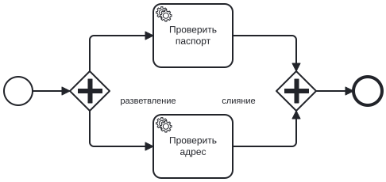
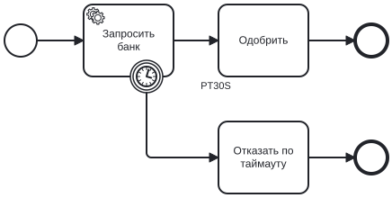
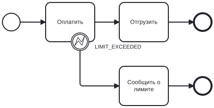
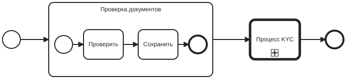

# Моделирование BPMN

Справочник: какие элементы BPMN понимает go-bpm, как их настроить в Camunda Modeler, что из них генерируется и как
они исполняются. Принципы исполнения — в [Принципах работы](concepts.md), код — в [Генераторе](generator.md).

## Чем рисовать

[Camunda Modeler](https://camunda.com/download/modeler/) (desktop) или [demo.bpmn.io](https://demo.bpmn.io/) (без
расширений Camunda). При создании файла выбирайте **Camunda 8** — go-bpm читает атрибуты `zeebe:*`: тип service task,
скрипты, решения, вызовы процессов. У user task дополнительно понимаются атрибуты Camunda 7 (`camunda:*`).

Файлы кладутся в `process/` (подпапки допустимы): `*.bpmn` — процессы, `*.dmn` — решения. Другие файлы генератор
не читает.

## Общие правила

- **Процесс** — `bpmn:process`. Его `id` — имя процесса в API, консоли и `StartProcess` (`OrderApproval`), `name` —
  название в консоли («Согласование заказа»). В одном файле может быть несколько процессов (пулы).
- **Id процессов уникальны** во всех файлах. Id элементов уникальны внутри процесса.
- **Id элементов становятся именами Go-функций**: `CheckOrder` → `CheckOrder`, `Activity_0shk46q` → `Activity0shk46q`,
  `Gateway_1nptppd` → `gateway1nptppd`. Понятные id делают код читаемым — задавайте их в моделере (поле ID).
- **Id процесса становится именем пакета**: `OrderApproval` → `order_approval`. Нельзя называть процесс `handlers`,
  `model`, `services` — эти папки заняты.
- **Переходы** — sequence flow с `sourceRef` и `targetRef`. `<bpmn:incoming>`/`<bpmn:outgoing>` внутри узлов
  (моделер пишет их всегда) необязательны, но если они есть, то должны совпадать с sequence flow — иначе ошибка
  генерации. Порядок `<bpmn:outgoing>` у шлюза — порядок проверки условий.
- **Переменные в выражениях** (условия, скрипты, DMN) — поля `DataModel`. Путь через точку `client.address.city` —
  вложенные структуры модели. Если поля нет, генератор остановится и подскажет, какое поле добавить.

## Сводная таблица


| Элемент | Поддержка | Как исполняется |
|---|---|---|
| Start event (none) | ✓ | начало процесса |
| End event (none) | ✓ | конец процесса или подпроцесса |
| Sequence flow, в том числе с условием | ✓ | переход |
| Exclusive gateway | ✓ | одна ветка: условия по порядку, иначе default flow |
| Parallel gateway | ✓ | разветвление во все ветки; слияние ждёт все входящие |
| Task | ✓ | ваш Go-метод, синхронно |
| Script task (`zeebe:script`) | ✓ | сгенерированный Go-код, синхронно |
| Service task (`zeebe:taskDefinition`) | ✓ | ваш обработчик, асинхронно через очередь, с повторами |
| Business rule task (`zeebe:calledDecision`) | ✓ | сгенерированное решение DMN, синхронно |
| User task | ✓ | ждёт человека, API задач |
| Receive task (`messageRef`) | ✓ | ждёт сообщение, `POST /api/v1/messages` |
| Intermediate timer catch event | ✓ | ждёт `timeDuration` или до `timeDate` |
| Intermediate message catch event | ✓ | ждёт сообщение, как receive task |
| Boundary timer event (прерывающий) | ✓ | у task, scriptTask, serviceTask, userTask |
| Boundary error event (прерывающий) | ✓ | у task, scriptTask, serviceTask |
| Embedded sub-process | ✓ | отдельный дочерний экземпляр |
| Call activity (`zeebe:calledElement`) | ✓ | экземпляр другого процесса |
| Последовательный multi-instance | ✓ | у задач, подпроцесса и call activity: `loopCardinality` и/или `completionCondition` |
| Всё остальное | ✗ | см. [что не поддерживается](#что-не-поддерживается) |

## События начала и конца

Обычные (none) start и end event. У процесса и у подпроцесса ровно один start event. End event может быть несколько:
экземпляр завершается на первом, до которого дошёл токен. Start event с таймером, сообщением или сигналом и end event
с terminate, error или message — ошибка генерации.

> Несведённые параллельные ветки, которые идут к разным end event, завершат экземпляр на первом из них: движок не
> считает токены. Сводите параллельные ветки слиянием перед концом.

## Sequence flow и условия

Условие задаётся на исходящем переходе exclusive gateway: панель свойств → Condition → Condition expression.
Условия на переходах из других элементов (conditional flow из задачи) — ошибка генерации: ставьте перед ветками шлюз.
По той же причине задача или событие могут иметь только один исходящий переход — разветвление делается шлюзом.

```xml
<bpmn:sequenceFlow id="Flow_big" sourceRef="IsBig" targetRef="Approve">
  <bpmn:conditionExpression xsi:type="bpmn:tFormalExpression">=amount &gt; 1000</bpmn:conditionExpression>
</bpmn:sequenceFlow>
```

Условие переводится в Go-выражение над полями модели. Ведущий `=` (так пишет моделер Camunda 8) отбрасывается.

| В BPMN | В Go | Примечание |
|---|---|---|
| `amount > 1000` | `data.Amount > 1000` | сравнения `== != < <= > >=` |
| `amount = 55` | `data.Amount == 55` | одиночное `=` FEEL — равенство |
| `status == "new"` | `data.Status == "new"` | строки — в двойных кавычках |
| `approved` | `data.Approved` | bool-поле само по себе условие |
| `a > 1 and b < 2` | `data.A > 1 && data.B < 2` | `and`, `or` FEEL или `&&`, `\|\|` Go |
| `not(approved)` | `!(data.Approved)` | |
| `client.age >= 18` | `data.Client.Age >= 18` | путь — вложенные структуры модели |
| `len(items) > 0` | `len(data.Items) > 0` | встроенные функции Go остаются вызовами |

Типы проверяет компилятор: поле `int`, а в условии `1.5` — ошибка на генерации. FEEL-функции (`contains()`,
`date()`, `string length()`) не переводятся — пишите их Go-эквиваленты или выносите логику в метод.

## Exclusive gateway


- Условия проверяются по порядку исходящих переходов, побеждает первое истинное.
- **Default flow** — ветка, если ни одно условие не подошло (в моделере: ключ на переходе → «Default flow»). Если
  default нет и ничего не подошло — ошибка шага, экземпляр упадёт после повторов. Ставьте default всегда.
- Каждый выход шлюза — либо с условием, либо default. Выход без условия, который не default, — ошибка генерации:
  токен по нему не пошёл бы никогда.
- Генерируется `cond_<id шлюза>.go`:

```go
// gatewayApproved возвращает id следующего элемента после Gateway_approved
func gatewayApproved(data *model.DataModel) string {
	// в процессе: approved
	if data.Approved {
		return "Flow_approved"
	}
	return "Flow_rework"
}
```

Exclusive gateway без условий (один выход или слияние веток) — просто проход.

## Parallel gateway

- **Разветвление** (один вход, несколько выходов): токен идёт во все ветки; каждая получает копию переменных.
- **Слияние** (несколько входов): ждёт, пока придут все входящие ветки, объединяет их переменные и идёт дальше.
  Число ожидаемых веток — число входящих переходов.
- **Слияние и разветвление сразу** (несколько входов и выходов): дождаться всех веток и разойтись во все выходы.



Если ветки меняют одну и ту же переменную, после слияния останется значение одной из них. Пишите в ветках разные
переменные.

Ветки из одних синхронных задач (task, scriptTask) выполняются в одном шаге друг за другом. Настоящий параллелизм —
у веток с service task: обработчики выполняются отдельными задачами очереди, одновременно (до `TaskWorkers` на
jobType).

## Task — ваш метод

Обычная задача (Task, без типа). Генерируется заготовка `method_<id>.go`, которую вы дописываете:

```go
// CheckOrder - метод задачи CheckOrder «Проверить заказ»
func CheckOrder(ctx context.Context, svc *services.Services, data *model.DataModel) error {
	if data.Amount <= 0 {
		return fmt.Errorf("сумма заказа должна быть положительной: %v", data.Amount)
	}
	data.Checked = true
	return nil
}
```

- Выполняется синхронно, внутри шага процесса, в транзакции шага.
- `data` — переменные процесса в вашей модели; изменения полей пишутся обратно в переменные.
- `svc` — ваши сервисы (клиенты баз, API), см. [Генератор → сервисы](generator.md#сервисы).
- Ошибка — шаг откатывается и повторяется (до `SystemMaxAttempts`, по умолчанию 10).
- `bpm.NewError(code, message)` — бизнес-ошибка, её ловит [граничное событие ошибки](#граничное-событие-ошибки).
- **Метод может выполниться несколько раз** (повтор шага). Подходит для расчётов и чтения. Внешние действия с
  побочными эффектами (платёж, письмо) делайте в service task.
- Долгий метод занимает воркер системной очереди (их `SystemWorkers`, по умолчанию 4) и ограничен
  `AttemptTimeout` (30 с). Долгое — в service task.

## Script task — код в схеме

Панель свойств → Implementation: FEEL expression / Script. Два режима.

**С `resultVariable` — выражение**, результат пишется в поле модели:

```xml
<bpmn:scriptTask id="Greet">
  <bpmn:extensionElements>
    <zeebe:script expression="=name + &#34;!&#34;" resultVariable="greeting" />
  </bpmn:extensionElements>
</bpmn:scriptTask>
```

```go
data.Greeting = data.Name + "!"
```

Здесь каждое имя — поле модели, иначе генератор потребует его добавить.

**Без `resultVariable` — код Go**, вставляется в тело метода как есть:

```xml
<zeebe:script expression="=fmt.Println(&#34;Hey&#34;)" />
```

```go
func Activity0shk46q(ctx context.Context, svc *services.Services, data *model.DataModel) error {
	fmt.Println("Hey")
	return nil
}
```

В коде в поля переводятся только имена, которые есть в модели; пакеты (`fmt`, `strings`) импортируются
автоматически. Метод скрипта генерируется — рукописный файл с тем же именем будет ошибкой.

## Service task — асинхронный обработчик

Панель свойств → Task definition: **Type** (jobType) и **Retries**.

```xml
<bpmn:serviceTask id="Notify" name="Уведомить клиента">
  <bpmn:extensionElements>
    <zeebe:taskDefinition type="notifyClient" retries="3" />
  </bpmn:extensionElements>
</bpmn:serviceTask>
```

Генерируется заготовка обработчика `handlers/<job_type>.go`:

```go
func NotifyClient(ctx context.Context, svc *services.Services, job bpm.Job, data *model.DataModel) error {
	// ...
	data.Notified = true
	return nil
}
```

Как исполняется:

1. Токен приходит в задачу — в очередь ставится задача `bpm.task.notifyClient`, шаг заканчивается
   (событие `activated`).
2. Воркер очереди вызывает обработчик. Изменения `data` пишутся в переменные процесса.
3. В той же транзакции, что завершает задачу, токен идёт дальше.

- **Retries** — число попыток. Нет атрибута или `0` — одна попытка. Между попытками — растущая задержка.
- **`job`**: `InstanceUid`, `ProcessName`, `BusinessKey`, `ElementId`, `JobType`, `LastAttempt` (это последняя
  попытка). `Headers` всегда пусты: заголовки задачи (`zeebe:taskHeaders`) генератор не читает.
- **Идемпотентность.** Обработчик может быть вызван повторно, даже после успеха (упала транзакция завершения).
  Ключ идемпотентности — `job.InstanceUid + job.ElementId`.
- **Один jobType — один обработчик** во всех процессах сервиса. Какой процесс вызвал — `job.ProcessName`.
- Ошибки: обычная — повтор; `bpm.NewError` — граничное событие ошибки или падение без повторов, если события нет;
  попытки кончились — граничное событие ошибки без кода или `failed`. Подробнее —
  [граничное событие ошибки](#граничное-событие-ошибки).
- Сколько задач одного jobType выполняется одновременно — `TaskWorkers` (по умолчанию 1) на каждый экземпляр сервиса.

## Business rule task — решение DMN

Панель свойств → Implementation: DMN decision, **Decision ID** и **Result variable**.

```xml
<bpmn:businessRuleTask id="CalcDiscount" name="Рассчитать скидку">
  <bpmn:extensionElements>
    <zeebe:calledDecision decisionId="Discount" resultVariable="discount" />
  </bpmn:extensionElements>
</bpmn:businessRuleTask>
```

Метод задачи генерируется полностью: вызывает решение, записывает сработавшие правила в историю и кладёт результат
в поле `resultVariable`. Решение должно лежать в одном из `*.dmn` в `process/`. Всё о таблицах — в
[Решениях DMN](dmn.md).

## User task — задача человека

Токен останавливается и ждёт, пока задачу выполнят через API или консоль. Настройки — панель свойств → Assignment и
Form.

```xml
<bpmn:userTask id="Approve" name="Согласовать заявку">
  <bpmn:extensionElements>
    <zeebe:assignmentDefinition candidateGroups="managers, admins" />
    <zeebe:formDefinition formKey="approve-form" />
  </bpmn:extensionElements>
</bpmn:userTask>
<bpmn:userTask id="Fix" name="Исправить заявку">
  <bpmn:extensionElements>
    <zeebe:assignmentDefinition assignee="=initiator" />
  </bpmn:extensionElements>
</bpmn:userTask>
```

| Настройка | Camunda 8 (`zeebe:`) | Camunda 7 (`camunda:`) |
|---|---|---|
| Исполнитель | `assignmentDefinition assignee` | атрибут `camunda:assignee` |
| Кандидаты-пользователи | `assignmentDefinition candidateUsers` | `camunda:candidateUsers` |
| Кандидаты-группы | `assignmentDefinition candidateGroups` | `camunda:candidateGroups` |
| Форма | `formDefinition formKey` или `formId` | `camunda:formKey` |

Атрибуты Camunda 7 важнее, если заданы оба варианта.

**Значения:**

- литерал: `managers`, `alice`;
- список — через запятую: `managers, admins`;
- переменная процесса — `=initiator`, `${initiator}` или `#{initiator}`, путь через точку: `=order.owner`.
  Переменная может быть строкой или списком строк (для кандидатов).

Другие выражения (`${a + b}`, FEEL-списки `=["a","b"]`) — ошибка генерации. Переменные назначения не обязаны быть
полями `DataModel`.

**Если переменная не вычислилась** (её нет, она не строка, у исполнителя несколько значений), значение пропускается
с предупреждением `user task assignment skipped` в логе, а задача создаётся без него. Без исполнителя и без
кандидатов задачу может взять любой. Так процесс не застревает из-за данных.

`formKey` движок не интерпретирует: это метка, по которой ваш фронтенд выбирает форму.

Как работать с задачами — [HTTP API → задачи](api.md#задачи-пользователей) и
[Принципы → задачи пользователей](concepts.md#задачи-пользователей).

## Таймер

Промежуточное событие-таймер (Intermediate catch event → Timer): токен ждёт заданное время.

```xml
<bpmn:intermediateCatchEvent id="Wait">
  <bpmn:timerEventDefinition>
    <bpmn:timeDuration xsi:type="bpmn:tFormalExpression">PT3S</bpmn:timeDuration>
  </bpmn:timerEventDefinition>
</bpmn:intermediateCatchEvent>
```

- **Duration** в ISO 8601: `PT30S`, `PT5M`, `PT1H30M`, `P1D`, `P1DT2H`. Годы и месяцы (`P1M`) не
  поддерживаются — их длина непостоянна. Формат Go (`2s`) — ошибка.
- **Date** — ждать до момента времени. Дата и время RFC 3339 с зоной (`2026-12-01T09:00:00+03:00`) или переменная
  процесса с такой строкой (`=dueDate`, `${order.dueDate}`). Срок вычисляется, когда токен приходит в таймер;
  если он уже прошёл — таймер срабатывает сразу. Переменной нет или в ней не дата — шаг падает, экземпляр станет
  `failed`, его можно перезапустить с исправленными переменными. Выражения FEEL сложнее переменной не поддерживаются.

  ```xml
  <bpmn:timerEventDefinition>
    <bpmn:timeDate xsi:type="bpmn:tFormalExpression">=dueDate</bpmn:timeDate>
  </bpmn:timerEventDefinition>
  ```
- `timeCycle` (повторение) не поддерживается.
- Таймер — отложенная задача очереди: не занимает воркер, переживает перезапуск сервиса. Точность — около секунды
  (интервал опроса очереди).

## Граничные события

Событие на краю задачи. Поддерживаются **прерывающие** (`cancelActivity` по умолчанию true) граничные события
**таймера и ошибки** у **task, scriptTask и serviceTask** и **граничный таймер** у **userTask**. Когда событие
срабатывает, задача прерывается (в истории — `terminated`), токен идёт по исходящему переходу события.
Таймер — длительность или дата, как у [промежуточного таймера](#таймер).

### Граничный таймер



- **Service task:** обработчик и таймер соревнуются. Кто первый закончил — того и ветка, результат проигравшего
  отбрасывается. Обработчик, который уже выполняется, не прерывается — его результат просто не используется.
- **Task и scriptTask:** таймер — это `context.WithTimeout` на метод. Сработает, только если метод слушает `ctx`
  (передаёт его в HTTP-клиент, базу, `select` на `ctx.Done()`). Результат метода после дедлайна отбрасывается.
- **User task** — эскалация по сроку. Если задачу не завершили вовремя, она становится `cancelled`, а токен идёт по
  событию: например, на задачу руководителю. Завершить её после этого нельзя — API ответит 409. Кто первый сменил
  статус задачи — человек через `complete` или таймер, — того и ветка: оба не сработают.

  ```xml
  <bpmn:boundaryEvent id="Overdue" attachedToRef="Approve">
    <bpmn:timerEventDefinition><bpmn:timeDuration>P3D</bpmn:timeDuration></bpmn:timerEventDefinition>
  </bpmn:boundaryEvent>
  ```

  Граничное событие ошибки у user task не поддерживается: задачу завершает человек, ошибок она не возвращает.

### Граничное событие ошибки



Ловит бизнес-ошибку задачи:

```go
return bpm.NewError("LIMIT_EXCEEDED", "превышен лимит клиента")
```

```xml
<bpmn:error id="Error_limit" name="Лимит превышен" errorCode="LIMIT_EXCEEDED" />
...
<bpmn:boundaryEvent id="OnLimit" attachedToRef="Pay">
  <bpmn:errorEventDefinition errorRef="Error_limit" />
</bpmn:boundaryEvent>
```

- Событие с `errorRef` ловит ошибку с этим кодом, событие без `errorRef` — любую.
- Код и текст ошибки кладутся в переменные `errorCode` и `errorMessage` — их видно в истории и можно использовать
  дальше в процессе (добавьте поля в модель).
- **Task/scriptTask:** пойманная `bpm.Error` — переход по событию в том же шаге. Непойманная `bpm.Error` и
  обычная ошибка — повтор шага.
- **Service task:** пойманная `bpm.Error` — переход по событию. Непойманная `bpm.Error` — задача падает сразу, без
  повторов. Обычная ошибка повторяется до `retries`, а после последней попытки её ловит событие **без кода**, если
  оно есть.

## Сообщения

Receive task или промежуточное событие сообщения (Intermediate catch event → Message): токен ждёт, пока сервис
не передаст сообщение. Так процесс ждёт ответ внешней системы, оплату, подпись — без опроса из service task.

```xml
<bpmn:receiveTask id="WaitPayment" name="Дождаться оплаты" messageRef="Message_payment" />
<!-- в definitions, рядом с process -->
<bpmn:message id="Message_payment" name="paymentReceived">
  <bpmn:extensionElements>
    <zeebe:subscription correlationKey="=orderId" />
  </bpmn:extensionElements>
</bpmn:message>
```

- Сообщение находит токен по **имени** (`name` у `bpmn:message`, константа) и **ключу корреляции**.
- Ключ корреляции — **бизнес-ключ экземпляра**, если `zeebe:subscription` не задан. С `correlationKey="=orderId"`
  ключ — значение переменной процесса (строка или число), когда токен пришёл в ожидание. Пустой ключ — шаг падает.
- Передать сообщение — `engine.CorrelateMessage(ctx, name, key, variables)` или
  [`POST /api/v1/messages`](api.md#сообщения). Переменные сообщения добавляются к переменным процесса. Сообщение
  получают **все** токены, которые ждут это имя и ключ.
- **Сообщение раньше ожидания.** Внешняя система часто отвечает раньше, чем токен дойдёт до receive task: запрос
  ушёл из service task, а ответ пришёл до коммита её шага. С `engine.WithMessageTTL(10*time.Minute)` (`"ttl"` в
  API) сообщение, которое никто не ждёт, сохраняется и достаётся первому токену, который подпишется в течение ttl.
  Без ttl такое сообщение — ошибка `ErrMessageNotCorrelated` (404). Просроченные сообщения удаляет
  [очистка истории](running.md#очистка-истории).
- `CorrelateMessageTx` передаёт сообщение в транзакции сервиса, как `StartProcessTx` — старт.
- Граничные события сообщения, старт по сообщению и выражения в имени сообщения не поддерживаются.

## Подпроцесс

Встроенный sub-process: группа элементов со своим start и end event внутри процесса. Справа на схеме — call activity
(жирная рамка), о нём в следующем разделе.



- Исполняется как **отдельный дочерний экземпляр** с типом `<процесс>.<id подпроцесса>`; в консоли родитель и
  ребёнок связаны ссылками.
- Получает переменные родителя; по окончании переменные возвращаются в родителя.
- Граничные события у подпроцесса и подпроцесс внутри подпроцесса не поддерживаются (ошибка генерации). Глубокую
  вложенность выносите в отдельный процесс и call activity.

## Call activity

Вызов другого процесса как подпрограммы. Панель свойств → Called element: **Process ID**, флажок
**Propagate all child variables**.

```xml
<bpmn:callActivity id="Activity_1d5xa2z" name="Некий подпроцесс">
  <bpmn:extensionElements>
    <zeebe:calledElement processId="testSubProcess" propagateAllChildVariables="false" />
  </bpmn:extensionElements>
</bpmn:callActivity>
```

- Вызванный процесс — отдельный экземпляр со ссылкой на родителя, наследует бизнес-ключ.
- Получает копию переменных родителя.
- `propagateAllChildVariables="true"` (по умолчанию) — переменные ребёнка возвращаются в родителя;
  `"false"` — родитель продолжает со своими прежними переменными.
- Вызываемый процесс должен быть в том же сервисе (в `process/`). Маппинг входов и выходов (`zeebe:ioMapping`)
  не поддерживается.

## Последовательный multi-instance

Маркер «три горизонтальные черты» у задачи, подпроцесса или call activity: элемент выполняется несколько раз подряд.
В Camunda Modeler: гаечный ключ на элементе → **Sequential multi-instance**, затем в XML или панели свойств — число
выполнений и условие завершения.

```xml
<bpmn:userTask id="Review" name="Согласовать (до трёх кругов)">
  <bpmn:multiInstanceLoopCharacteristics isSequential="true">
    <bpmn:loopCardinality xsi:type="bpmn:tFormalExpression">3</bpmn:loopCardinality>
    <bpmn:completionCondition xsi:type="bpmn:tFormalExpression">=approved</bpmn:completionCondition>
  </bpmn:multiInstanceLoopCharacteristics>
</bpmn:userTask>
```

- `loopCardinality` — сколько раз выполнить элемент, целая константа больше нуля. Выражения не поддерживаются.
- `completionCondition` — условие завершения, как условие шлюза: FEEL или Go на переменных процесса, генерируется
  в `loop_<id>.go`. Проверяется **после** каждого выполнения: `true` — цикл закончен.
- Нужно хотя бы одно из двух. Если заданы оба, цикл кончается тем, что наступит раньше. Только с условием цикл идёт,
  пока условие не выполнится.
- Номер выполнения, с 1, — переменная `loopCounter`. Её видят элемент и условие. Чтобы читать её в методе или
  условии, добавьте в модель поле `` LoopCounter int `json:"loopCounter,omitempty"` `` (`omitempty`: метод вне цикла
  не запишет переменную нулём). После цикла переменной нет.
- Переменные переходят из выполнения в выполнение: то, что записал первый проход, видит второй.
- Каждое выполнение task и scriptTask — отдельный шаг очереди: упавшее выполнение повторяется одно, не весь цикл.
- Граничное событие ошибки прерывает весь цикл. Граничный таймер у элемента с циклом не поддерживается: в BPMN он
  ограничивает весь цикл, а не одно выполнение.
- Не поддерживаются параллельный multi-instance (`isSequential` не задан), цикл по коллекции
  (`zeebe:loopCharacteristics inputCollection`, `camunda:collection`) и standard loop.

## Что не поддерживается

Генератор отвергает всё неподдерживаемое с ошибкой, которая называет элемент: процесс, который сгенерировался, не
упадёт в рантайме из-за непонятого элемента.

**Элементы:**

- inclusive gateway, event-based gateway, complex gateway;
- manual task, send task;
- промежуточные throw events, signal catch events, event sub-process;
- подпроцесс внутри подпроцесса, transaction, ad-hoc sub-process;
- параллельный multi-instance, multi-instance по коллекции, standard loop (см. [multi-instance](#последовательный-multi-instance));
- несколько start event, start event с таймером, сообщением или сигналом;
- end event с terminate, error, message, escalation.

**Настройки поддерживаемых элементов:**

- несколько исходящих переходов у задачи или события, условие на переходе не из exclusive gateway;
- выход exclusive gateway без условия, который не default flow;
- `<bpmn:incoming>`/`<bpmn:outgoing>`, которые не совпадают с sequence flow, и sequence flow к несуществующему элементу;
- непрерывающие граничные события (`cancelActivity="false"`);
- граничные события у подпроцесса, call activity и business rule task, граничная ошибка у user task;
- граничные события message, signal, escalation, compensation;
- таймер `timeCycle`, длительность не в ISO 8601 или с годами и месяцами, `timeDate` без зоны или выражением сложнее переменной;
- сообщение без имени, с выражением в имени или с `correlationKey` сложнее переменной;
- `errorRef` на несуществующую ошибку;
- выражения назначения user task сложнее переменной;
- business rule task с job worker (`zeebe:taskDefinition`) или без `decisionId`/`resultVariable`.

**Игнорируются без ошибки** (расширения внутри `extensionElements`): `zeebe:ioMapping` (входы и выходы задач),
`zeebe:taskHeaders`, execution listeners. Документация, лейны, текстовые аннотации и объекты данных не исполняются и
генерации не мешают.

FEEL-функции в выражениях не переводятся — на них упадёт сборка сгенерированного кода.
