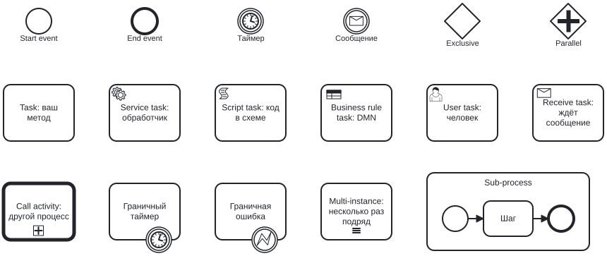

# Принципы работы

Эта страница — для тех, кто впервые видит BPMN и DMN, и для тех, кто знает их по Camunda и хочет понять, чем
go-bpm отличается. Первые два раздела — о самих нотациях, остальные — о том, как go-bpm их исполняет.

## BPMN за десять минут

BPMN (Business Process Model and Notation) — стандартная нотация для схем бизнес-процессов. Схема одновременно
документация, понятная аналитику, и исполняемая программа. Файл `.bpmn` — XML: в нём элементы процесса и
координаты для рисования.

### Токен

Исполнение процесса удобно представлять как фишку — **токен**, — которая ходит по схеме:

1. Процесс запускают — токен появляется в стартовом событии.
2. Токен идёт по стрелкам (sequence flow) от элемента к элементу. Задача выполняется, когда в неё пришёл токен.
3. Шлюз решает, куда токен пойдёт дальше: в одну из веток (exclusive) или во все сразу (parallel).
4. Токен дошёл до конечного события — экземпляр завершён.

Один запуск процесса — **экземпляр**. У каждого экземпляра свои **переменные** — данные, которые идут вместе
с токеном: задачи их читают и меняют, шлюзы по ним выбирают ветку.

### Основные элементы



Вот как они складываются в процесс — согласование заказа из [быстрого старта](quickstart.md#свой-сервис-с-нуля):


| Элемент | Смысл | Пример |
|---|---|---|
| Start event | Откуда начинается процесс | «Заявка поступила» |
| End event | Где заканчивается | «Заявка закрыта» |
| Task | Действие без уточнения, как оно делается | «Проверить заказ» |
| Service task | Вызов системы, обычно асинхронный и с повторами | «Отправить письмо», «Списать деньги» |
| Script task | Короткий расчёт прямо в схеме | `total = price * qty` |
| User task | Работа человека: ждёт, пока её кто-то выполнит | «Согласовать заявку» |
| Business rule task | Вызов таблицы решений DMN | «Рассчитать скидку» |
| Exclusive gateway | Ровно одна ветка: первая с истинным условием или ветка по умолчанию | «Сумма > 1000?» |
| Parallel gateway | Разветвление — во все ветки сразу; слияние — ждать все входящие ветки | «Проверить паспорт и адрес параллельно» |
| Timer (промежуточный) | Подождать заданное время | «Подождать 1 час» |
| Boundary event | Событие на краю задачи: прервать её по таймеру или ошибке и уйти другой веткой | «Если банк не ответил за 30 секунд» |
| Sub-process | Кусок процесса, свёрнутый в один блок | |
| Call activity | Вызвать другой процесс как подпрограмму | «Процесс KYC» |

Полный список того, что поддерживает go-bpm, с настройками — в [Моделировании BPMN](bpmn.md).

## DMN за пять минут

DMN (Decision Model and Notation) — нотация для бизнес-правил. Основной её инструмент — **таблица решений**:
столбцы входов, столбцы выходов, строки-правила.

| | Вход: сумма | Вход: категория клиента | Выход: скидка |
|---|---|---|---|
| 1 | `>= 10000` | `"vip"` | `15` |
| 2 | `>= 10000` | `-` | `10` |
| 3 | `-` | `"vip"` | `5` |
| 4 | `-` | `-` | `0` |

- **Ячейка входа** — условие на значение входа (unary test): `>= 10000`, `"vip"`, `[1..10]`, `-` — «любое значение».
- **Правило срабатывает**, если выполнены все его ячейки.
- **Hit policy** говорит, что делать, если сработало несколько правил: взять первое (`FIRST`), считать это ошибкой
  моделирования (`UNIQUE`), собрать все (`COLLECT`), сложить (`COLLECT SUM`) и т.д.

В процессе таблицу вызывает **business rule task**: передаёт входы из переменных процесса и пишет результат
в переменную. Правила меняются в таблице — без правки кода методов. Подробно — [Решения DMN](dmn.md).

## Как go-bpm исполняет процесс

### Генерация вместо интерпретации

Классические движки (Camunda, Flowable) читают BPMN в рантайме и вычисляют выражения интерпретатором (FEEL, JUEL).
go-bpm делает это заранее, на этапе `go generate`:

```
process/*.bpmn, *.dmn  ──go-bpm-gen──→  Go-код: схема процесса, условия, скрипты, решения
                                          + заготовки методов и обработчиков (пишете вы)
                                                      │
                                                 go build
                                                      ▼
                         ваш сервис: engine + queue + сгенерированный код  ──→  PostgreSQL
```

Что это даёт:

- **Ошибки — на генерации.** Условие `amount > "x"`, переменная, которой нет в модели, метод с неверной сигнатурой —
  генератор собирает код и показывает ошибку компилятора.
- **Типы.** Методы получают `*model.DataModel`, а не `map[string]any`.
- **Скорость и простота.** Условие шлюза — обычный `if` в Go, решение DMN — цепочка `if`. Никакого интерпретатора и
  кэша скомпилированных выражений.
- **Процесс версионируется вместе с кодом.** BPMN лежит в репозитории сервиса, изменения проходят ревью и
  выкатываются обычным деплоем.

Цена: поменять процесс без пересборки сервиса нельзя. Деплоя BPMN «на лету», как в Camunda, нет.

### Очередь задач и шаги

Движок построен на очереди задач в таблице `bpm_queue`. Есть два вида задач:

- **системные** (`bpm.system`) — старт процесса, шаг после service task, срабатывание таймера, завершение задачи
  пользователя;
- **задачи service task** (`bpm.task.<jobType>`) — вызов вашего обработчика.

Воркеры очереди берут задачи (`select ... for update skip locked`), поэтому сервис можно запускать в нескольких
экземплярах на одной базе — задачи распределятся между ними.

**Шаг** — то, что делает одна задача очереди. Он проводит токен через все синхронные элементы, пока токен не
дойдёт до места, где нужно ждать:

```
                         ┌──────────── один шаг, одна транзакция ────────────┐
StartProcess → задача →  │ Start → [метод] → <шлюз> → [скрипт] → [service task] │ → задача обработчика → ...
  (API)       очереди    └───────────────────────────────────── ставит задачу ┘
```

Точки ожидания, на которых шаг заканчивается:

| Где | Чего ждём | Что продолжит процесс |
|---|---|---|
| Service task | обработчик jobType | задача `bpm.task.<jobType>` выполнилась |
| Таймер | заданное время | отложенная системная задача |
| User task | человека | вызов `Complete` через API |
| Слияние parallel gateway | остальные ветки | последняя пришедшая ветка |
| End event | — | экземпляр завершён (или токен вернулся в родительский процесс) |

Методы (`task`, `scriptTask`, `businessRuleTask`), условия шлюзов, подпроцессы и разветвления выполняются внутри
шага. Поэтому цепочка методов проходит за миллисекунды, а параллельные ветки из одних методов выполняются в одном
шаге **по очереди**, а не одновременно. Одновременно выполняются ветки, где есть service task: каждая ставит свою
задачу очереди.

### Транзакция шага

Всё, что меняет шаг, пишется в одной транзакции с завершением задачи очереди:

- новые задачи очереди (service task, таймеры, следующий шаг);
- история элементов и правил;
- строка экземпляра и его статус;
- задачи пользователей;
- счётчики слияния параллельных веток.

Отсюда главная гарантия: **шаг применяется целиком или не применяется вовсе.** Упал метод, упала база, убили под —
транзакция откатывается, задача очереди возвращается и выполняется снова. Токен не теряется и не раздваивается,
в истории нет «полушагов».

Следствие для вашего кода:

- **Методы могут выполняться повторно.** Шаг повторяется целиком, вместе со всеми методами в нём. Метод не должен
  делать необратимых внешних действий (платёж, письмо) — для этого есть service task.
- **Обработчики service task тоже могут выполняться повторно** (at-least-once): обработчик отработал, а транзакция
  завершения не закоммитилась. Обработчик должен быть идемпотентным; ключ — `job.InstanceUid + job.ElementId`.

### Повторы и падения

| Что упало | Что происходит |
|---|---|
| Метод, условие шлюза, решение DMN | шаг откатывается и повторяется очередью: до `SystemMaxAttempts` (10) попыток с растущей задержкой |
| Обработчик service task | повторяется задача обработчика: до `retries` из BPMN попыток |
| `bpm.NewError(code, ...)` с граничным событием ошибки | не падение, а переход по ветке события |
| Попытки кончились | задача очереди — `failed`, экземпляр и его родители — `failed` |

Задержка повтора начинается с `RetryDelay` (1 с), удваивается с каждой попыткой (не больше 5 минут) и
рандомизируется, чтобы повторы разных задач не шли волной.

Упавшая задача остаётся в `bpm_queue` со статусом `failed` и текстом ошибки. Её можно перезапустить, исправив
причину, — см. [упавшие экземпляры](running.md#упавшие-экземпляры).

### Переменные и модель данных

Переменные экземпляра хранятся как JSON-объект. Методы, обработчики, условия и решения видят их через вашу
Go-структуру `DataModel`:

```
переменные (JSON)  ──json.Unmarshal──→  *DataModel  ──метод меняет поля──→  json.Marshal  ──поверх переменных──→  переменные
```

- Поле получает переменную по тегу `json`: ``Amount float64 `json:"amount"` `` ← `amount`.
- После метода **все** поля модели записываются в переменные, в том числе нулевые. Поле с `omitempty` в нулевом
  значении переменную не трогает.
- Переменные, которых нет в модели, сохраняются как есть: метод их не видит, но и не теряет.
- Одна модель на все процессы сервиса. Переменная с одним именем — один тип во всех процессах.

### Экземпляры, история, статусы

Если включена запись в базу (`History.ToDB`), движок ведёт:

- **экземпляры** (`bpm_process_instance`): процесс, бизнес-ключ, родитель, статус, время создания и обновления;
- **историю элементов** (`bpm_history`): каждое прохождение элемента — `activated` (задача поставлена и ждёт),
  `completed` (выполнена), `terminated` (прервана граничным событием) — с переменными у задач;
- **историю правил** (`bpm_rules_history`): какое решение вызвано, какие правила сработали, результат.

Статусы экземпляра:

```
running ──End event──→ completed
   └──── попытки шага кончились ──→ failed
```

Экземпляр появляется в базе вместе с задачей старта, в одной транзакции, — сразу со статусом `running`, ещё до первого
шага. Если первый шаг упадёт, экземпляр так и будет виден как `running`, пока не кончатся попытки, а потом станет
`failed`.

### Подпроцессы и call activity

Встроенный подпроцесс и вызванный процесс (call activity) — **отдельные экземпляры** со своим id и ссылкой на
родителя. Родитель ждёт их End event, после чего токен возвращается в родителя и идёт дальше.

- Дочерний экземпляр получает копию переменных родителя.
- Call activity по умолчанию возвращает переменные ребёнка в родителя (`propagateAllChildVariables`), при `false`
  у родителя остаются его прежние переменные.
- Бизнес-ключ наследуется.
- Если упал ребёнок — `failed` получают и ребёнок, и все его предки.

### Задачи пользователей

User task останавливает токен и создаёт строку в `bpm_user_task`. Дальше всё как в Camunda 7:

```
            ┌─ assignee задан ──────→ личная задача исполнителя ──┐
создана ────┤                                                      ├── Complete(user, variables) ──→ процесс идёт дальше
            └─ кандидаты ──→ очередь ──Claim(user)──→ в работе ────┘
                                ↑──────── Unclaim ────────┘
```

- **Исполнитель** (`assignee`) — задача сразу его.
- **Кандидаты** — пользователи (`candidateUsers`) и группы (`candidateGroups`): задача в их общей очереди, один
  из них берёт её в работу (`Claim`), после чего она только его.
- Ни исполнителя, ни кандидатов — задачу может взять любой.
- Выполнить (`Complete`) может только исполнитель; переменные формы добавляются к переменным процесса.

Кто пользователь и в каких он группах, движок не знает: это передаёт ваш сервис в каждом запросе. Авторизация —
ваша.

### Чем go-bpm не является

- **Не сервер процессов.** Нет деплоя BPMN без пересборки, нет мультитенантности, нет отдельного REST-сервера:
  движок живёт в вашем процессе.
- **Не полная реализация BPMN и FEEL.** Поддерживается практичное подмножество: см. списки «не поддерживается» в
  [BPMN](bpmn.md#что-не-поддерживается) и [DMN](dmn.md#что-не-поддерживается). Неподдерживаемые настройки
  поддерживаемых элементов (непрерывающий таймер, hit policy `PRIORITY`) и элементы, которых он не знает
  (inclusive gateway, manual task, message event), генератор отвергает с ошибкой — процесс, который сгенерировался,
  не упадёт в рантайме из-за непонятого элемента.
- **Не планировщик реального времени.** Таймер срабатывает с точностью до интервала опроса очереди (около секунды).
