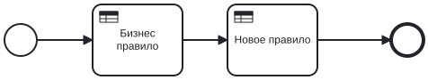
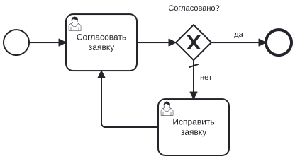
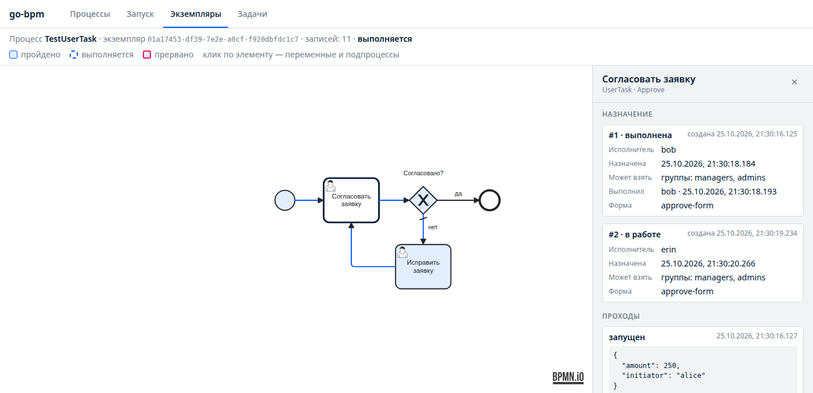
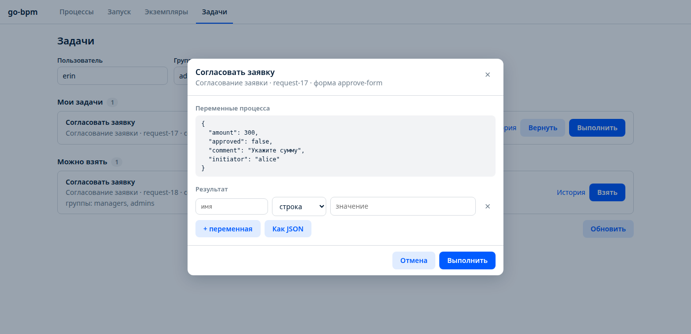
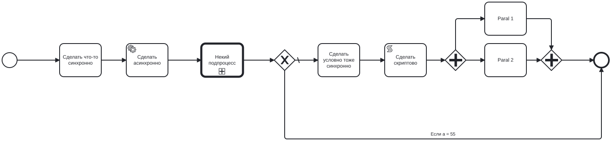
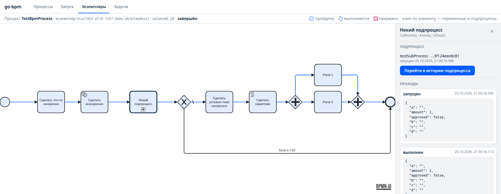
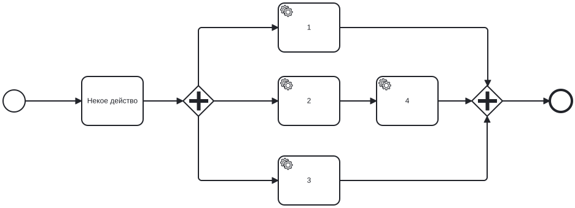
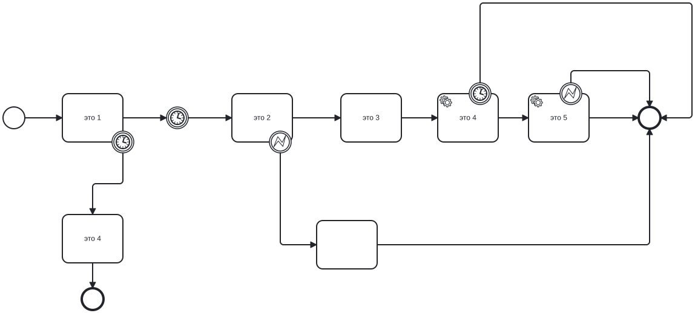
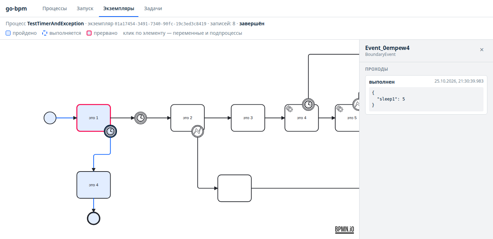
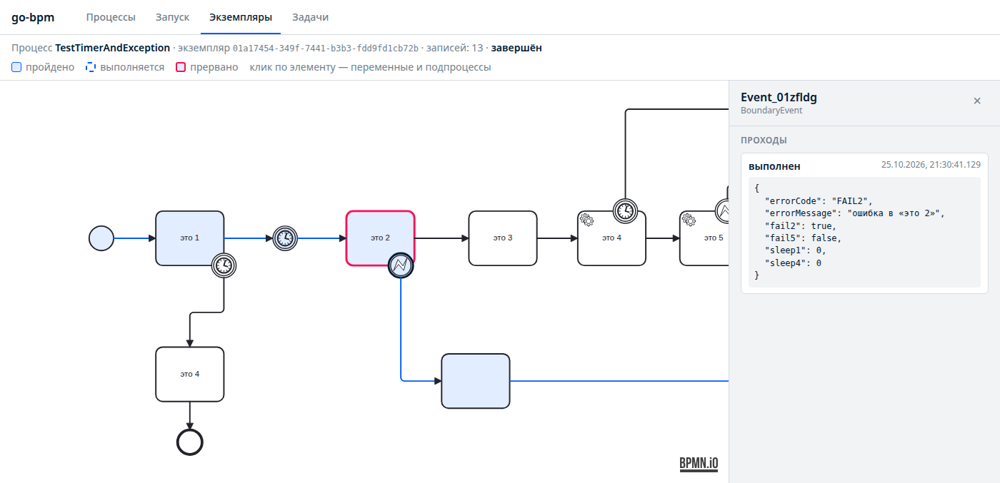

# Разбор примеров

В `examples/demo` — демо-сервис с пятью процессами. Каждый показывает свою часть go-bpm. Для каждого ниже: схема,
как он устроен в BPMN, что сгенерировано, как запустить и что увидеть.

Запуск демо — [Быстрый старт](quickstart.md#демо-за-пять-минут). Команды ниже предполагают сервис на `:8080`.

| Процесс | Файл | Что показывает |
|---|---|---|
| [`TestDecision`](#testdecision-бизнес-правила-dmn) | `testBusinessRule.bpmn`, `businessRule.dmn` | бизнес-правила DMN, история правил |
| [`TestUserTask`](#testusertask-задачи-пользователей) | `testUserTask.bpmn` | задачи пользователей, группы, исполнитель из переменной, цикл |
| [`TestBpmProcess`](#testbpmprocess-шлюзы-скрипт-параллельные-ветки-call-activity) | `test-bpm-engine.bpmn` | методы, service task, call activity, exclusive и parallel gateway, script task |
| [`testSubProcess`](#testsubprocess-параллельные-service-task) | `testSubProcess.bpmn` | параллельные service task со слиянием |
| [`TestTimerAndException`](#testtimerandexception-таймеры-и-ошибки) | `testTimerAndException.bpmn` | таймер, граничные таймеры и ошибки |

Общие файлы демо:

- `bpmgen/model/data_model.go` — модель: `Amount int` (шлюз `TestBpmProcess`), `A`, `B`, `C`, `D string` (решения
  `TestDecision`), `Approved bool` (шлюз `TestUserTask`);
- `bpmgen/services/services.go` — пустой `Services`: внешних зависимостей у демо нет;
- `bpmgen/handlers/` — обработчики `doSomeAsync`, `failingTask`, `slowTask`, `paralel1`…`paralel4` — заглушки,
  которые сразу возвращают `nil`;
- `cmd/demo/main.go` — сервис: миграции, движок, API, консоль, флаги истории.

---

## TestDecision: бизнес-правила DMN



Две business rule task подряд: первая считает `c` по `a` и `b`, вторая — `d` по `a` и только что посчитанному `c`.
Так в go-bpm собираются цепочки решений (зависимых решений `requiredDecision` нет).

### BPMN и DMN

```xml
<bpmn:businessRuleTask id="Activity_0xzljrt" name="Бизнес правило">
  <bpmn:extensionElements>
    <zeebe:calledDecision decisionId="Decision_1" resultVariable="c" />
  </bpmn:extensionElements>
</bpmn:businessRuleTask>
```

`Decision_1` «Test Decision», hit policy UNIQUE (по умолчанию):

| Правило | `a` (string) | `b` (string) | `c` |
|---|---|---|---|
| `DecisionRule_04e4bk8` | `"foo"` | `"bar"` | `"correct foobar"` |
| `DecisionRule_1a2n073` | `"some"` | `-` | `"some a"` |
| `DecisionRule_0t56a5i` | `-` | `"some"` | `"some b"` |
| `DecisionRule_1kb19kv` | `-` | `-` | `"default"` |

`SubDecision` «Sub Decision»:

| Правило | `a` | `c` | `d` |
|---|---|---|---|
| `DecisionRule_1fpl3ms` | `"some"` | `"red"` | `"make KYC cool!"` |
| `DecisionRule_0le0cvg` | `-` | `-` | `""` |

Правила `Decision_1` пересекаются (`a = "some"`, `b = "some"` подходит под два правила) — для UNIQUE это ошибка
моделирования, но go-bpm пересечения не проверяет и возвращает первое подошедшее.

### Сгенерированный код

`test_decision/decision_decision_1.go`:

```go
func decideDecision1(data *model.DataModel) (string, []string) {
	a := data.A // Некая переменная a
	b := data.B // Некая переменная b

	// DecisionRule_04e4bk8: "foo" | "bar" => "correct foobar"
	if a == "foo" && b == "bar" {
		return "correct foobar", []string{"DecisionRule_04e4bk8"}
	}
	// DecisionRule_1a2n073: "some" | - => "some a"
	if a == "some" {
		return "some a", []string{"DecisionRule_1a2n073"}
	}
	// DecisionRule_0t56a5i: - | "some" => "some b"
	if b == "some" {
		return "some b", []string{"DecisionRule_0t56a5i"}
	}
	// DecisionRule_1kb19kv: - | - => "default"
	return "default", []string{"DecisionRule_1kb19kv"}
}
```

`test_decision/method_activity_0xzljrt.go` вызывает решение, пишет вызов в историю и кладёт результат в `data.C`.

### Запуск

```sh
for v in '{"a":"some","b":"x"}' '{"a":"foo","b":"bar"}' '{"a":"z","b":"some"}' '{"a":"z","b":"z"}'; do
  curl -XPOST localhost:8080/api/v1/processes/TestDecision/instances -d "{\"variables\":$v}"
done
```

| Входы | `c` (правило) | `d` (правило) |
|---|---|---|
| `a=some, b=x` | `some a` (`DecisionRule_1a2n073`) | `""` (`DecisionRule_0le0cvg`) |
| `a=foo, b=bar` | `correct foobar` (`DecisionRule_04e4bk8`) | `""` |
| `a=z, b=some` | `some b` (`DecisionRule_0t56a5i`) | `""` |
| `a=z, b=z` | `default` (`DecisionRule_1kb19kv`) | `""` |

`SubDecision` всегда даёт `""`: правило `"make KYC cool!"` требует `c = "red"`, а `Decision_1` такого значения не
выдаёт. Хотите его увидеть — добавьте в `Decision_1` правило с выходом `"red"` и перегенерируйте.

В консоли откройте экземпляр и кликните по «Бизнес правило» → «Показать сработавшие правила»: таблица `Decision_1`
с подсвеченной строкой.


---

## TestUserTask: задачи пользователей



- «Согласовать заявку» (`Approve`) — для групп `managers` и `admins`, форма `approve-form`.
- «Согласовано?» — по переменной `approved` из формы.
- «Исправить заявку» (`Fix`) — исполнитель из переменной `initiator`, после исправления — снова согласование.

### BPMN

```xml
<bpmn:userTask id="Approve" name="Согласовать заявку">
  <bpmn:extensionElements>
    <zeebe:assignmentDefinition candidateGroups="managers, admins" />
    <zeebe:formDefinition formKey="approve-form" />
  </bpmn:extensionElements>
</bpmn:userTask>
<bpmn:exclusiveGateway id="Gateway_approved" name="Согласовано?" default="Flow_rework" />
<bpmn:sequenceFlow id="Flow_approved" name="да" sourceRef="Gateway_approved" targetRef="EndEvent_1">
  <bpmn:conditionExpression xsi:type="bpmn:tFormalExpression">=approved</bpmn:conditionExpression>
</bpmn:sequenceFlow>
<bpmn:userTask id="Fix" name="Исправить заявку">
  <bpmn:extensionElements>
    <zeebe:assignmentDefinition assignee="=initiator" />
  </bpmn:extensionElements>
</bpmn:userTask>
```

### Сгенерированный код

В `flow-gen.go` user task — данные, без методов:

```go
"Approve": {
	ElementId:    "Approve",
	ActivateType: bpm.ActivateTypeUserTask,
	NextElements: []string{"Flow_decided"},
	UserTask: &bpm.UserTask{
		Name:            "Согласовать заявку",
		CandidateGroups: []string{"managers", "admins"},
		FormKey:         "approve-form",
	},
},
"Fix": {
	// ...
	UserTask: &bpm.UserTask{
		Name:     "Исправить заявку",
		Assignee: "${initiator}",
	},
},
```

`=initiator` записан как `${initiator}` — так движок понимает, что это переменная. Условие шлюза —
`cond_gateway_approved.go`: `if data.Approved { return "Flow_approved" }`, иначе default `Flow_rework`.

### Запуск: согласовать с первого раза

```sh
curl -XPOST localhost:8080/api/v1/processes/TestUserTask/instances \
  -d '{"variables":{"initiator":"alice"},"businessKey":"request-1"}'

# очередь bob из группы managers
curl 'localhost:8080/api/v1/tasks?candidateUser=bob&candidateGroup=managers'

curl -XPOST localhost:8080/api/v1/tasks/<task_uid>/claim    -d '{"userId":"bob","groups":["managers"]}'
curl -XPOST localhost:8080/api/v1/tasks/<task_uid>/complete -d '{"userId":"bob","variables":{"approved":true}}'
```

Экземпляр завершён: `GET /api/v1/instances?businessKey=request-1` → `"status": "completed"`.

### Запуск: вернуть на исправление

Выполните «Согласовать» с `{"approved": false, "comment": "нет суммы"}`. Появится задача «Исправить заявку», сразу
назначенная `alice`:

```sh
curl 'localhost:8080/api/v1/tasks?assignee=alice'
curl localhost:8080/api/v1/tasks/<task_uid>    # с variables: initiator, approved, comment — данные для формы
curl -XPOST localhost:8080/api/v1/tasks/<task_uid>/complete -d '{"userId":"alice","variables":{"amount":100}}'
```

Берите её в работу не нужно — она уже назначена. После выполнения снова появится «Согласовать заявку» для групп.

### Что посмотреть

- **Консоль → Задачи:** пользователь `bob`, группы `managers` — «Можно взять»; пользователь `alice` — «Мои задачи».
- **Ошибки API:** `carol` из группы `accounting` получит 403 на `claim`, `bob` — 409 на `complete` чужой задачи.
- **История экземпляра:** клик по «Согласовать заявку» — блок «Назначение»: по карточке на каждый приход токена,
  кто брал, когда, кто мог взять. На снимке заявка прошла круг: bob вернул её на исправление, alice исправила,
  и вторую задачу согласования взяла в работу erin.

  

- **Выполнение задачи** в консоли: переменные процесса на момент создания задачи и редактор результата.

  
- **Без `initiator`:** запустите процесс без переменных и верните на исправление. В логе
  `user task assignment skipped`, задача «Исправить» без исполнителя и кандидатов — её видит и может взять любой.

---

## TestBpmProcess: шлюзы, скрипт, параллельные ветки, call activity



### Что внутри

| Элемент | Тип | Код |
|---|---|---|
| `MySimpleMethod` | task | `method_my_simple_method.go` — рукописный, заглушка |
| `Activity_08uf92k` | service task `doSomeAsync` | `handlers/do_some_async.go` — заглушка |
| `Activity_1d5xa2z` | call activity `testSubProcess`, `propagateAllChildVariables="false"` | — |
| `Gateway_1nptppd` | exclusive, `=amount == 55`, default — «нет» | `cond_gateway_1nptppd.go` |
| `MySecondSimpleMethod` | task | заглушка |
| `Activity_0shk46q` | script task `=fmt.Println("Hey")` | `method_activity_0shk46q.go` — сгенерирован |
| `Gateway_0l6eu7y` → `ParalMethod1`, `ParalMethod2` → `Gateway_0nsow60` | parallel: разветвление и слияние | `ParallelSyncQuantity: 2` у слияния |

Скрипт без `resultVariable` — это Go-код, `fmt` импортирован автоматически:

```go
// Activity0shk46q - скрипт задачи Activity_0shk46q «Сделать скриптово»
func Activity0shk46q(ctx context.Context, svc *services.Services, data *model.DataModel) error {
	fmt.Println("Hey")
	return nil
}
```

Условие шлюза:

```go
func gateway1nptppd(data *model.DataModel) string {
	// в процессе: amount == 55
	if data.Amount == 55 {
		return "Flow_0fs8mon"
	}
	return "Flow_1wibfjd"
}
```

Изначально переменная называлась `a`, но в модели `A string` занят решением `TestDecision`. Одна модель на все
процессы, поэтому переменная переименована в `amount`.

### Запуск

```sh
curl -XPOST localhost:8080/api/v1/processes/TestBpmProcess/instances -d '{"variables":{"amount":55}}'
curl -XPOST localhost:8080/api/v1/processes/TestBpmProcess/instances -d '{"variables":{"amount":1}}'
```

- `amount = 55`: после подпроцесса — сразу End.
- `amount = 1`: ветка «нет» — в логе сервиса `Hey`, затем две параллельные ветки и слияние.
- В обоих случаях в списке экземпляров два: `TestBpmProcess` и `testSubProcess` с `parent_instance_uid`
  родителя. В истории родителя клик по «Некий подпроцесс» → ссылка на дочерний экземпляр, двойной клик — переход.



`Paral 1` и `Paral 2` — синхронные методы, поэтому выполняются в одном шаге друг за другом. Слияние
`Gateway_0nsow60` ждёт обе ветки: первая пришедшая записывает себя в `bpm_parallel_sync`, вторая продолжает.

---

## testSubProcess: параллельные service task

Процесс, который вызывает `TestBpmProcess`. Его можно запустить и сам по себе.



- Разветвление на три ветки, слияние ждёт три (`ParallelSyncQuantity: 3`).
- Все задачи веток — service task: каждая ставит свою задачу очереди, и обработчики разных jobType выполняются
  одновременно. Вторая ветка — две service task подряд.
- `NormalMethodName` — пример понятного id: обработчик всё равно называется по jobType (`Paral3`), а не по id.

```sh
curl -XPOST localhost:8080/api/v1/processes/testSubProcess/instances -d '{}'
```

В истории видно `activated` и `completed` у каждой service task и порядок прихода веток к слиянию.

---

## TestTimerAndException: таймеры и ошибки



| Элемент | Что это |
|---|---|
| `Activity_0t9anfq` «это 1» | task с граничным таймером `PT2S` → «это 4» (метод) → End |
| `Event_1k62vrn` | промежуточный таймер `PT3S` |
| `Activity_0jxex4s` «это 2» | task с граничной ошибкой без кода → безымянная задача `Activity_02og8xf` → End |
| `Activity_0fk214d` «это 3» | task |
| `Activity_0hnpv77` «это 4» | service task `slowTask` с граничным таймером `PT1S` → End |
| `Activity_0fazco9` «это 5» | service task `failingTask` с граничной ошибкой без кода → End |

В `flow-gen.go` граничные события — у задач:

```go
"Activity_0hnpv77": {
	ElementId:    "Activity_0hnpv77",
	ActivateType: bpm.ActivateTypeQueue,
	NextElements: []string{"Flow_0cnlbwr"},
	TaskType:     "slowTask",
	Boundaries: []bpm.Boundary{
		{ElementId: "Event_12ry18w", Type: bpm.BoundaryTypeTimer, Timer: 1 * time.Second},
	},
},
```

### С заглушками

Методы и обработчики демо — заглушки, поэтому процесс идёт по основному пути: «это 1» → ждёт 3 секунды → «это 2» →
«это 3» → «это 4» → «это 5» → End. Граничные события не срабатывают.

```sh
curl -XPOST localhost:8080/api/v1/processes/TestTimerAndException/instances -d '{}'
```

### Эксперименты: заставить события сработать

Чтобы увидеть каждую ветку, допишите заглушки так, чтобы ими управляли переменные. Поля в модель:

```go
// model/data_model.go
Sleep1 int  `json:"sleep1"` // секунд в «это 1»
Fail2  bool `json:"fail2"`  // бизнес-ошибка в «это 2»
Sleep4 int  `json:"sleep4"` // секунд в slowTask
Fail5  bool `json:"fail5"`  // техническая ошибка в failingTask
```

«это 1» — метод, который слушает `ctx` (иначе граничный таймер метода не сработает):

```go
func Activity0t9anfq(ctx context.Context, svc *services.Services, data *model.DataModel) error {
	select {
	case <-time.After(time.Duration(data.Sleep1) * time.Second):
		return nil
	case <-ctx.Done():
		return ctx.Err()
	}
}
```

«это 2» — бизнес-ошибка:

```go
func Activity0jxex4s(ctx context.Context, svc *services.Services, data *model.DataModel) error {
	if data.Fail2 {
		return bpm.NewError("FAIL2", "ошибка в «это 2»")
	}
	return nil
}
```

Обработчики:

```go
func SlowTask(ctx context.Context, svc *services.Services, job bpm.Job, data *model.DataModel) error {
	time.Sleep(time.Duration(data.Sleep4) * time.Second)
	return nil
}

func FailingTask(ctx context.Context, svc *services.Services, job bpm.Job, data *model.DataModel) error {
	if data.Fail5 {
		return errors.New("внешняя система недоступна")
	}
	return nil
}
```

Результаты (история экземпляра без переходов):

**`{"sleep1": 5}`** — граничный таймер метода. В истории «это 1» обведена красным — прервана, дальше пройдена ветка
таймера:



```
terminated это 1
completed  таймер 2s у «это 1»
completed  это 4 (метод)
completed  End
```

**`{"fail2": true}`** — граничная ошибка метода, код и текст в переменных. В панели граничного события видны
`errorCode` и `errorMessage`:



```
completed  это 1
activated  таймер 3s
completed  таймер 3s
terminated это 2
completed  ошибка у «это 2»     errorCode=FAIL2 errorMessage=ошибка в «это 2»
completed  обработка ошибки
completed  End
```

**`{"sleep4": 3}`** — граничный таймер service task. Обработчик доработает свои 3 секунды, но его результат будет
отброшен (в логе `task result dropped: lease lost or task cancelled`):

```
...
activated  это 4 (slowTask)
terminated это 4 (slowTask)
completed  таймер 1s у slowTask
completed  End
```

**`{"fail5": true}`** — техническая ошибка service task. `retries` не задан — одна попытка, после неё ошибку ловит
граничное событие без кода. `errorCode` пустой, `errorMessage` — текст ошибки:

```
...
activated  это 5 (failingTask)
terminated это 5 (failingTask)
completed  ошибка у failingTask  errorMessage=внешняя система недоступна
completed  End
```

> **Таймер service task считает и время в очереди.** Если запустить `{"sleep4": 3}` и `{"fail5": true}` подряд,
> у второго экземпляра тоже сработает таймер `slowTask`: у jobType один воркер (`TaskWorkers = 1`), и задача
> ждала в очереди, пока первый обработчик спит. Граничный таймер отсчитывается от постановки задачи. Если задач
> одного jobType много, увеличьте `TaskWorkers` или число экземпляров сервиса. Так же считает и Camunda: таймер
> стартует, когда задача активирована, а не когда её взял воркер.

---

## Как сделать свой пример

1. Нарисуйте процесс в `examples/demo/process/` (или в `process/` своего сервиса).
2. `make generate` — генератор подскажет поля модели и создаст заготовки.
3. Допишите методы и обработчики, `make generate` ещё раз (проверка сборки).
4. `make run`, запуск из консоли, разбор в истории экземпляра.

Пошагово, с нуля — в [Быстром старте](quickstart.md#свой-сервис-с-нуля).
